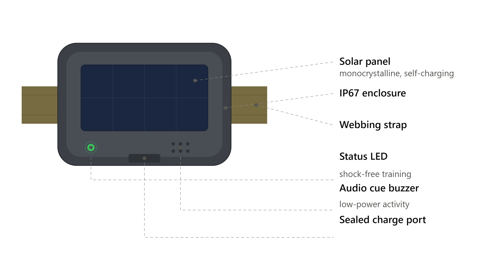
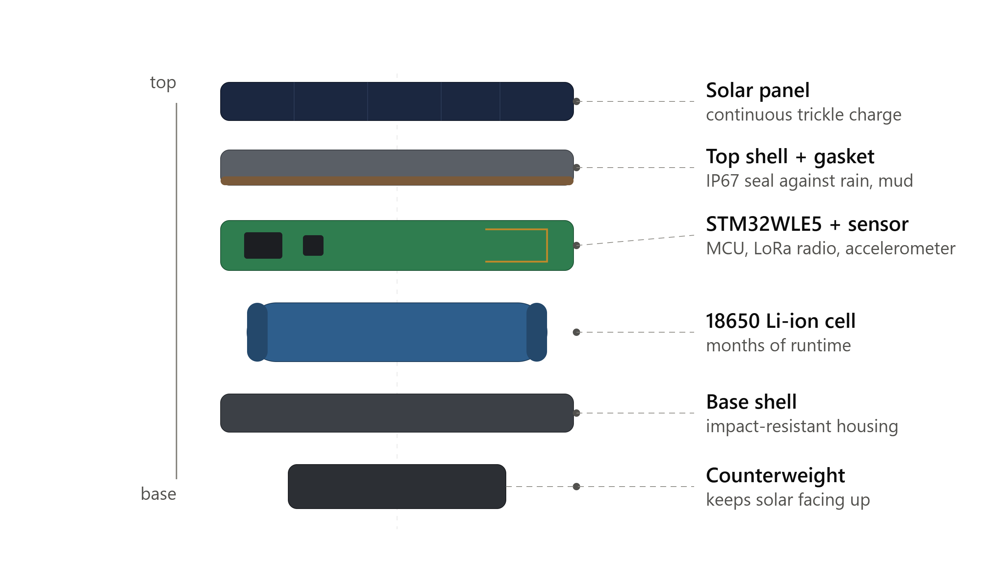
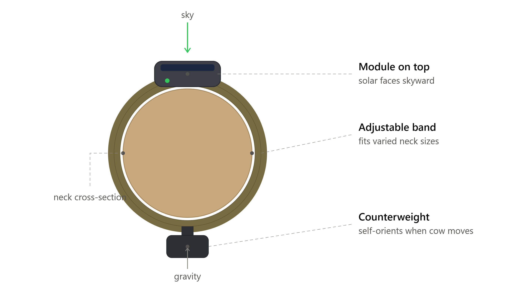
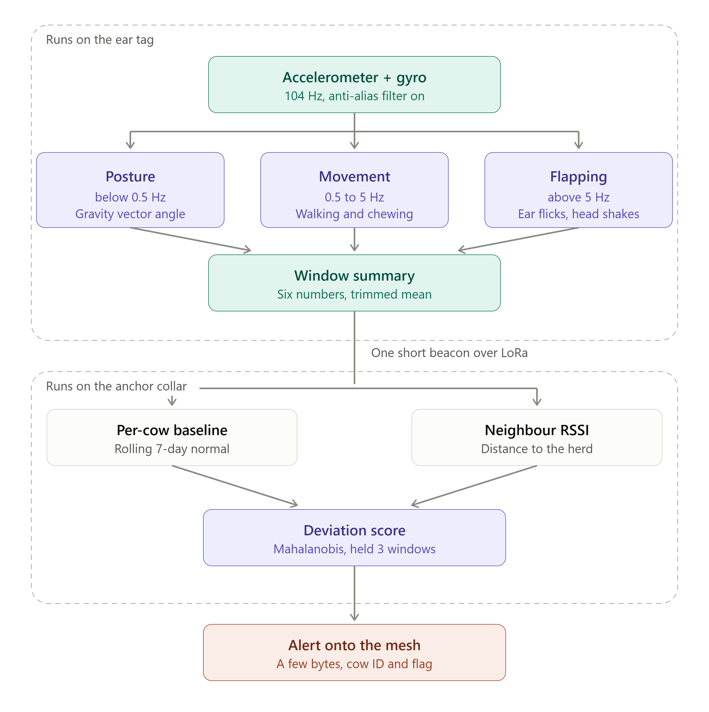
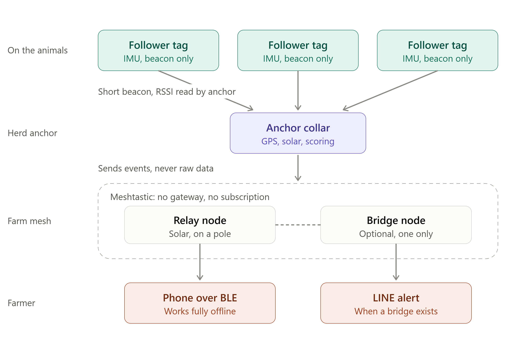
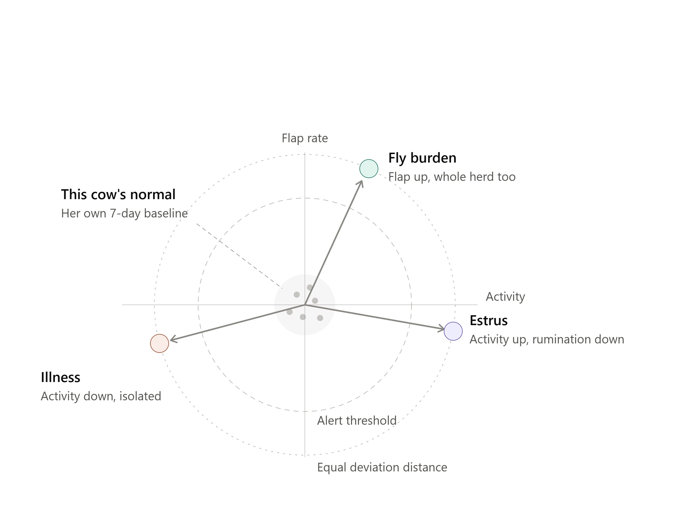
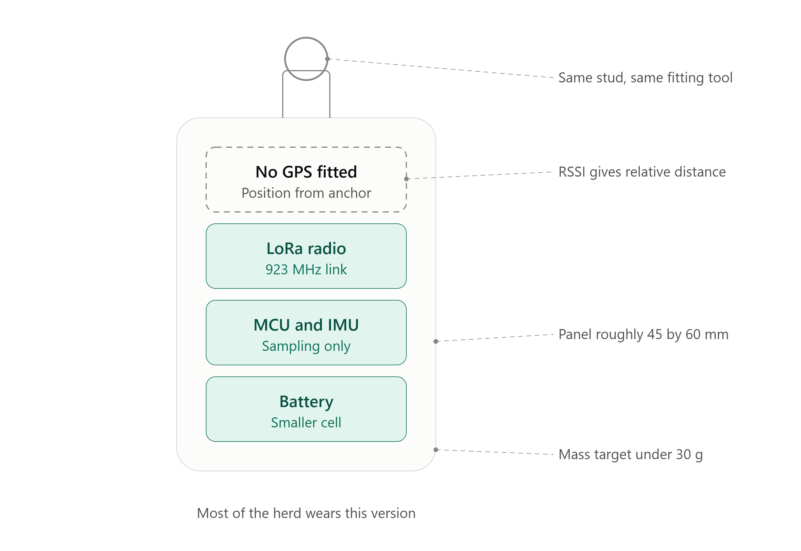

# COWLLAR---The-collar-that-knows-your-cows
This project was created for the KMITL AgiTech Hackathon 2026, where we designed a smart collar for cattle to improve production for local farms and SMEs.

Low-cost cattle herd monitoring for smallholder farms, built on LoRa mesh instead of cellular or commercial LoRaWAN infrastructure.

Commercial livestock monitoring collars (Nofence, Halter, Vence, eShepherd) are priced and shaped for Western ranching. COWLLAR targets the smallholder herd: a handful of cows, no reliable internet at the paddock, and a per-animal budget measured in hundreds of baht rather than thousands.




---

## What it does

Each cow wears a collar containing an IMU. The collar continuously scores the animal's motion against **its own** baseline and flags deviations that matter to the farmer — estrus, illness, and heavy fly burden — then pushes an alert to LINE.

Two things make this work at low cost:

**Anchor / follower topology.** Only a few collars in a herd carry GPS. The rest are follower nodes that locate themselves by LoRa RSSI relative to the anchors. GPS is the expensive part of the bill of materials, so this cuts the per-animal cost substantially while keeping herd-level position awareness.


**Meshtastic backhaul.** Collars form a LoRa mesh. One internet-connected node can serve an entire village; no LoRaWAN gateway subscription, and the system keeps logging and alerting while offline.


**Behavioral scoring.** Raw acceleration magnitude cannot tell estrus apart from a cow shaking off flies — both look like "more movement." COWLLAR decomposes IMU data into three frequency bands (posture below 0.5 Hz, locomotion 0.5–5 Hz, shake/scratch above 5 Hz) and scores the resulting feature vector by Mahalanobis distance from that individual cow's learned baseline. Because the score carries *direction* in feature space and not just magnitude, different anomalies separate from each other rather than collapsing into a single "unusual" flag.


---

## Repository layout

| Folder | Contents |
|---|---|
| `COWLLAR_tag/` | Collar node firmware — IMU sampling, frequency-band feature extraction, activity classification, radio transmit |
| `COWLLAR_cardputer_demo/` | M5Stack Cardputer receiver — live activity display used for the demo |
| `COWLLAR_Wireless Demo/` | Paired transmitter + receiver demo over ESP-NOW |
| `COWLLAR_logger/` | Session logging — captures raw IMU streams to file for offline analysis |
| `COWLLAR_labeller/` | Annotates logged sessions with ground-truth behavior labels |
| `tools/` | Python utilities (see below) |

### `tools/`

| Script | Purpose |
|---|---|
| `dump_tag.py` | Pull recorded data off a tag |
| `inspect_tag.py` | Inspect and sanity-check a captured session |
| `merge_labels.py` | Join labeller output with logged sensor data into a training set |
| `tune_thresholds.py` | Fit and sweep activity classification thresholds against labeled data |

---

## Hardware

- ESP32-S3 (collar node MCU)
- LSM6DS3 6-axis IMU
- M5Stack Cardputer (demo receiver / display)
- LoRa radio module (production link)

Firmware is built with **PlatformIO** on the `pioarduino` platform (Arduino core 3.x).

```bash
pio run -e <env> -t upload
pio device monitor
```

---

## Status and honest limitations

**The wireless demo runs on ESP-NOW, not LoRa.** This is a deliberate stand-in for presentation purposes — the protocol layer is swappable, but what you see running in the demo is not the production radio path.

**Behavioral detection is designed and implemented, not yet validated on animals.** A planned farm deployment did not proceed: the farmer's cattle were not habituated to wearing collars, so no on-animal data was collected. The classification pipeline, the frequency-band decomposition, and the scoring math all run on human-generated motion data. Distinguishing estrus from fly burden on real cattle requires labeled herd data that does not exist yet.

That habituation finding is itself part of what the project learned. Form factor is not a detail — a device the animal will not tolerate has an accuracy of zero regardless of how good the algorithm is.

---

## Roadmap

- **Ear tag tier.** Lightweight follower tags (IMU + RSSI, no GPS, sub-30 g target) as a per-animal option alongside anchor collars. Habituation cost drops toward zero; the tag joins the same Meshtastic architecture.


- **Deployment configurations.** Collar-only, or collar-plus-tags, chosen per farm.
- **On-animal calibration.** Retune activity thresholds and per-cow baselines against real labeled herd data.

---
